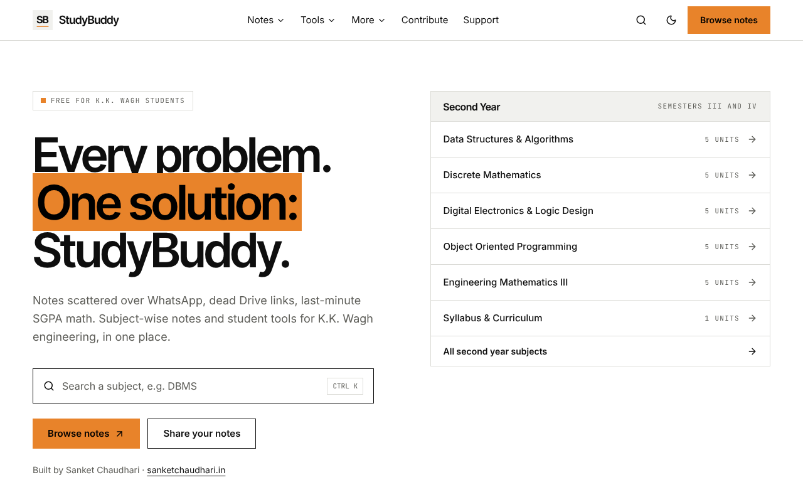
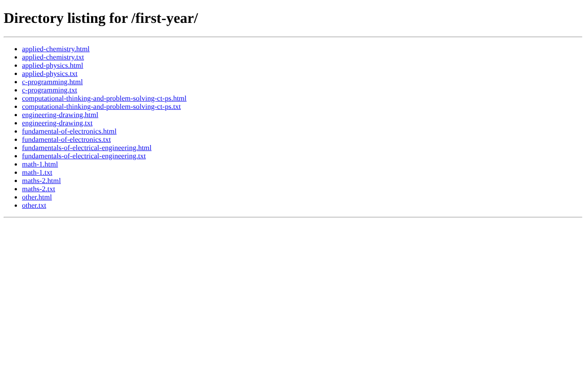
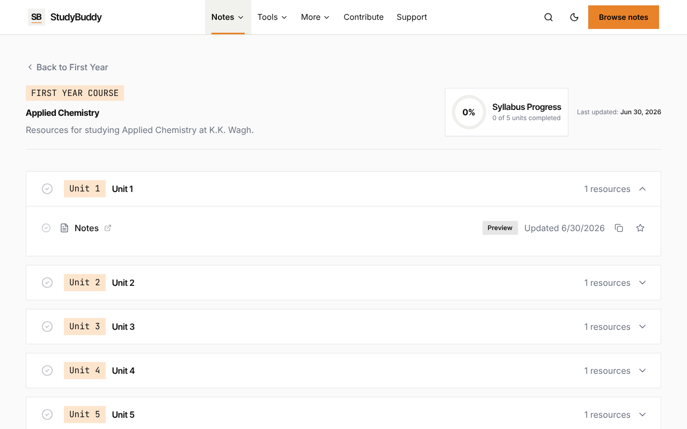
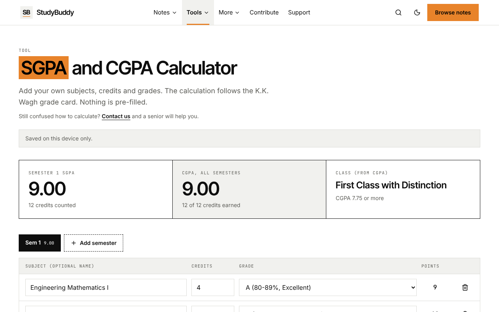
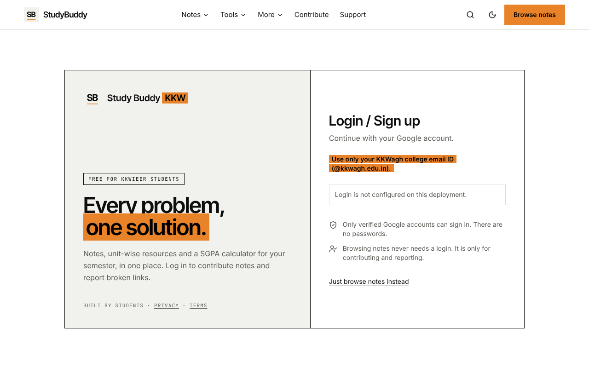
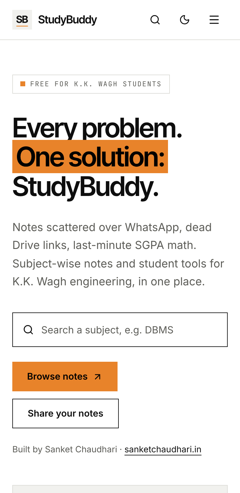
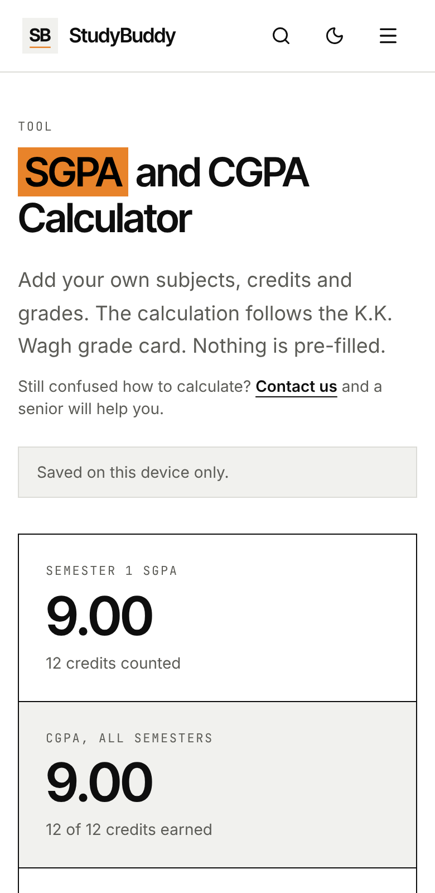

<div align="center">


# StudyBuddy KKW

**Free, open-source study hub for K.K. Wagh Institute of Engineering Education & Research (KKWIEER) students.**

Subject-wise notes, a grade-card accurate SGPA/CGPA calculator, instant search and a student contributor system, all in one place.

[**Live site**](https://www.studybuddykkw.dev) &nbsp;·&nbsp; [Contribute](CONTRIBUTING.md) &nbsp;·&nbsp; [Report a bug](../../issues) &nbsp;·&nbsp; [Request a feature](../../issues)

<br />

[](https://github.com/Sanket-103-pvt/StudyBuddy-KKW/actions/workflows/e2e.yml)
[](LICENSE)
[](CONTRIBUTING.md)


<br />



</div>

---

## Why this exists

Notes get lost in WhatsApp groups, Drive links die, and nobody remembers how the grade card turns grades into an SGPA. StudyBuddy puts the useful parts in one fast site that works on a phone, with no account needed to browse.

## Features

| | |
|---|---|
| **Notes by year, subject and unit** | Browse First and Second Year subjects, open a unit and get the notes link. Mark units as done and keep your progress on your own device. |
| **Instant search** | Press `Ctrl + K` (or tap the search icon) and jump to any subject. |
| **SGPA and CGPA calculator** | Follows the K.K. Wagh grade card: SGPA = Σ(credits × grade point) ÷ Σ credits, and CGPA over all semesters. Handles audit (AC, ACN) and non-countable (PP, NP) courses, shows the class awarded, and prints a clean statement. |
| **Grade card reference** | The grade table, class table and formula from the grade card, right under the calculator. |
| **Study analytics** | Progress per subject, stored only in your browser. |
| **Exam countdown and timetables** | Personal countdown, plus timetables shared by students and approved by an admin. |
| **Contributor system** | Sign in with a KKWagh Google account, submit a resource link, and an admin reviews it. Approved items go live and the contributor appears on a leaderboard. |
| **Light and dark themes** | Sharp, high-contrast design that reads well on small screens. |
| **Installable PWA** | Add it to your home screen, and recently opened pages work offline. |

### Privacy, by design

- Browsing needs no login and sets no tracking cookies.
- Calculator data stays on your device unless you sign in and choose to keep it in your account.
- Page views are counted with Cloudflare Web Analytics, which does not follow you across sites.
- Optional ads (Google AdSense) are off by default and, when enabled, load only after the visitor allows them. See the [Privacy Policy](app/privacy/page.tsx).

## Screenshots

<table>
  <tr>
    <td width="50%"><br /><sub><b>Subjects by year</b></sub></td>
    <td width="50%"><br /><sub><b>Units and notes</b></sub></td>
  </tr>
  <tr>
    <td width="50%"><br /><sub><b>SGPA and CGPA calculator</b></sub></td>
    <td width="50%"><br /><sub><b>KKWagh email login</b></sub></td>
  </tr>
</table>

<table>
  <tr>
    <td align="center"><br /><sub><b>Mobile home</b></sub></td>
    <td align="center"><br /><sub><b>Mobile calculator</b></sub></td>
  </tr>
</table>

> The calculator screenshots use made-up sample subjects. The real site never pre-fills data.

## Tech stack

| Area | Tools |
|---|---|
| Framework | Next.js 14 (App Router), React 18, TypeScript |
| Styling | Tailwind CSS, self-hosted Inter, Inter Tight and JetBrains Mono |
| Content | Plain JSON files in `content/`, validated against `content-schema.json` (AJV) |
| Auth and data | Supabase (Google sign-in restricted to `@kkwagh.edu.in`, Postgres with Row Level Security) |
| Hosting | Cloudflare (static export served from a Worker) |
| Monitoring | Cloudflare Web Analytics, optional Sentry for browser errors |
| Tests | Jest (unit), Cypress (end to end, runs in CI) |

## Getting started

You need Node.js 18+ and npm.

```bash
git clone https://github.com/Sanket-103-pvt/StudyBuddy-KKW.git
cd StudyBuddy-KKW
npm install
npm run dev
```

Open http://localhost:3000. Browsing, search and the calculator work without any setup.

Login, contributions, the admin page and the leaderboard switch on when Supabase is configured. See [`supabase/README.md`](supabase/README.md).

| Command | What it does |
|---|---|
| `npm run dev` | Start the development server |
| `npm run validate` | Check every file in `content/` against the schema |
| `npm test` | Run the Jest unit tests |
| `npm run lint` | Run ESLint |
| `npm run build` | Validate content, then build for production |

### Environment variables

Copy nothing into the repo. Put these in `.env.local` (local) or in your host's build settings. All are optional.

| Variable | Purpose |
|---|---|
| `NEXT_PUBLIC_SUPABASE_URL` | Supabase project URL (turns on login and contributions) |
| `NEXT_PUBLIC_SUPABASE_ANON_KEY` | Supabase anon public key (never use the `service_role` key) |
| `NEXT_PUBLIC_SENTRY_DSN` | Browser error reports (off when empty) |
| `NEXT_PUBLIC_ADSENSE_CLIENT` | Google AdSense publisher id, for example `ca-pub-123...` (ads stay off when empty) |
| `NEXT_PUBLIC_ADSENSE_SLOT_SUBJECT` | Ad unit id for subject pages |

## Deploying

The site has no server code, so it builds to plain files and runs on any static host. On Cloudflare:

```bash
# build command
STATIC_EXPORT=1 npm run build
# output directory
out
```

`wrangler.jsonc` points Cloudflare at `out/`, and `public/_headers` and `public/_redirects` carry the security headers and redirects. The daily Supabase keepalive runs from `.github/workflows/keepalive.yml` (add the two Supabase repository secrets).

## Project structure

```
app/            Pages and routes (Next.js App Router)
components/     UI components
content/        Subject notes as JSON (first-year, second-year, ...)
lib/            Calculator rules, search index, Supabase helpers
public/         Icons, manifest, _headers and _redirects
supabase/       SQL for the database and a setup guide
docs/           Screenshots and notes
__tests__/      Jest tests
cypress/        End-to-end tests
```

## Contributing

There are two ways to help:

- **Share notes (students).** Sign in on the site, open **Contribute**, and submit a link. An admin reviews it before it goes live.
- **Improve the code or content (developers).** Read [CONTRIBUTING.md](CONTRIBUTING.md), then open a pull request. Adding notes only needs a JSON edit in `content/`.

Please follow the [Code of Conduct](CODE_OF_CONDUCT.md).

## Roadmap

- Third and Fourth Year (AI&DS) notes, once there is real content for them
- Previous year question papers (subject, year and session wise)
- Verified notes from faculty, marked as verified
- Notifications when new notes are added

## License and credits

The code is released under the [MIT License](LICENSE). The StudyBuddy name and logo identify the official site, so please do not present a fork as the official StudyBuddy KKW.

Created and maintained by [Sanket Chaudhari](https://github.com/Sanket-103-pvt). Thanks to every student who shares notes and reports broken links.

<div align="center">

Made for the students of K.K. Wagh Institute of Engineering Education & Research.

</div>
